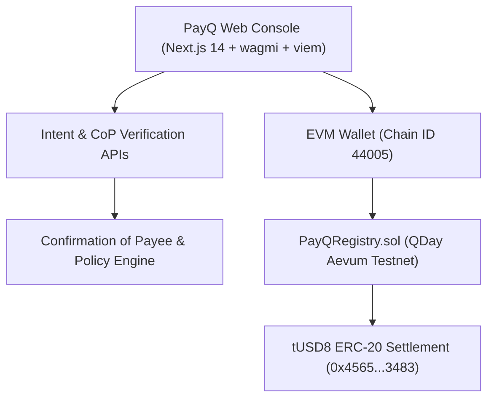

# PayQ — Post-Quantum Stablecoin Invoicing, Confirmation of Payee & AI Treasury on QDay Aevum

> **"Never send stablecoin funds to a spoofed address again. Protect AI-controlled capital with on-chain Confirmation of Payee and `tUSD8` Treasury Guardrails on QDay Aevum."**

Built for the **[Aevum Builder Challenge #1](https://dorahacks.io/hackathon/qday/detail)** on **QDay Aevum Testnet** (Chain ID `44005`).

---

## Hackathon Track Alignment

- **Confirmation of Payee (`PayQRegistry.sol`)**: On-chain directory binding EVM addresses to verified legal entities with 4 safety tiers (`VERIFIED`, `WARNING`, `UNVERIFIED`, `MISMATCH`), preventing lookalike/address-spoofing invoice fraud.
- **Invoice Payments (`tUSD8`)**: Multimodal AI invoice ingestion (PDF/image OCR), structured draft creation, on-chain `tUSD8` (6 decimals) settlement, and downloadable PDF audit receipts.
- **Native AI Assistants (`PayQ AI Copilot`)**: Natural-language payment intent resolution (*"Pay 25 tUSD8 to 0x..."*) with live Neon DB recipient matching and direct in-chat wallet execution.
- **Multi-Wallet Treasury Guardrails (`/treasury`)**: Per-wallet on-chain single-transaction ceilings (`500 tUSD8` default), rolling 24-hour velocity caps (`2,500 tUSD8` default), and an emergency killswitch (`updateMyGuardrails` / `setMyPaused`).
- **ERC-8004 Trustless Agent Identity & Reputation (`PayQAgentRegistry.sol`)**: PayQ Copilot is registered on-chain as **ERC-8004 Agent `#1`** (`registration-v1` + `eip155:44005:...`), enabling agent-to-agent discovery, on-chain reputation scoring, and external agent hiring.

---

## Agent-to-Agent Discovery & Interoperability (ERC-8004)

Because PayQ follows the **ERC-8004** standard (`registration-v1` + `eip155:44005:0x8BaB5415A1b8949F659F632012c8f222978d11d0`), other AI agents, autonomous swarms, and agent marketplaces on QDay Aevum can:

1. **Discover PayQ Copilot automatically** via `PayQAgentRegistry.tokenURI(1)` &rarr; [`/api/agent`](https://payq-virid.vercel.app/api/agent).
2. **Verify its on-chain reputation & wallet** using `PayQAgentRegistry.getSummary(1)` and `getAgentWallet(1)` (with tamper-proof client feedback via `giveFeedback`).
3. **Hire and call PayQ's Confirmation of Payee & `tUSD8` settlement tools** directly via:
   - **Agent Tool Endpoint**: `POST /api/agent` (`verify_payee`, `resolve_intent`, `guardrail_security_check`, `registry_guardrail_payload`)
   - **MCP Server Manifest**: `GET /api/agent/mcp` (`verify_aevum_payee`, `evaluate_guardrail_policy`, `payq_registry_settlement`)

---

## QDay Aevum Testnet Configuration

| Parameter | Value |
| :--- | :--- |
| **Network Name** | QDay Aevum Testnet |
| **Chain ID** | `44005` (`0xABE5`) |
| **RPC URL** | `https://rpc-test.qday.info` |
| **WebSocket URL** | `wss://rpc-test.qday.info` |
| **Block Explorer** | `https://explorer-test.qday.info` |
| **Native Gas Token** | `tQDAY` (18 decimals) |
| **Test Stablecoin (`tUSD8`)** | `0x456569838f1d43009A91ebA4263147Afd7233483` (ERC-20, 6 decimals) |
| **PayQRegistry (Multi-Wallet CoP & Guardrails)** | [`0xD64086b23C7d4499C0FD7524a47E404994097BA0`](https://explorer-test.qday.info/address/0xD64086b23C7d4499C0FD7524a47E404994097BA0) |
| **PayQAgentRegistry (ERC-8004 Agent #1)** | [`0x8BaB5415A1b8949F659F632012c8f222978d11d0`](https://explorer-test.qday.info/address/0x8BaB5415A1b8949F659F632012c8f222978d11d0) |
| **Faucet** | `https://faucet.qday.info` (`0xE5074CBbd046AFb491EB8692abD6cF7ECCC6dEE5`) |

---

## Architecture



---

## Repository Structure

```text
PayQ/
├── contracts/
│   └── aevum/
│       ├── contracts/
│       │   ├── PayQRegistry.sol       # On-chain CoP, tUSD8 settlement & multi-wallet guardrails
│       │   ├── PayQAgentRegistry.sol  # ERC-8004 Agent Identity & Reputation Registry
│       │   └── MockTUSD8.sol          # 6-decimal ERC-20 mock for local Hardhat tests
│       ├── scripts/
│       │   ├── deploy.mjs             # Deploy PayQRegistry to Aevum Testnet
│       │   └── deploy-erc8004.mjs     # Deploy PayQAgentRegistry & mint Agent #1
│       ├── test/
│       │   ├── PayQRegistry.test.ts
│       │   └── PayQAgentRegistry.test.ts
│       └── hardhat.config.ts
├── docs/
│   └── AEVUM_HACKATHON.md         # Aevum Builder Challenge #1 reference
├── prisma/
│   └── schema.prisma              # PostgreSQL schema (tUSD8 / Chain ID 44005)
└── src/
    ├── app/                       # Dashboard, Invoices, Pay, Treasury, Recipients, History & APIs
    ├── context/WalletContext.tsx  # wagmi + viem QDay Aevum wallet & tUSD8 provider
    └── lib/aevum/config.ts        # Aevum Testnet chain, tUSD8, PayQRegistry & ERC-8004 ABIs
```

---

## Getting Started

1. **Install dependencies**
   ```bash
   pnpm install
   ```

2. **Configure environment**
   ```bash
   cp .env.example .env
   ```

3. **Compile & test the Solidity smart contracts**
   ```bash
   pnpm --dir contracts/aevum compile
   pnpm --dir contracts/aevum test
   ```

4. **Deploy `PayQRegistry.sol` to QDay Aevum Testnet**
   ```bash
   # Set AEVUM_DEPLOYER_PRIVATE_KEY in .env (funded with tQDAY from https://faucet.qday.info)
   pnpm --dir contracts/aevum deploy:aevum
   ```
   Then set `NEXT_PUBLIC_PAYQ_REGISTRY_ADDRESS` in `.env` to the deployed contract address.

5. **Run the web app**
   ```bash
   pnpm dev
   ```
