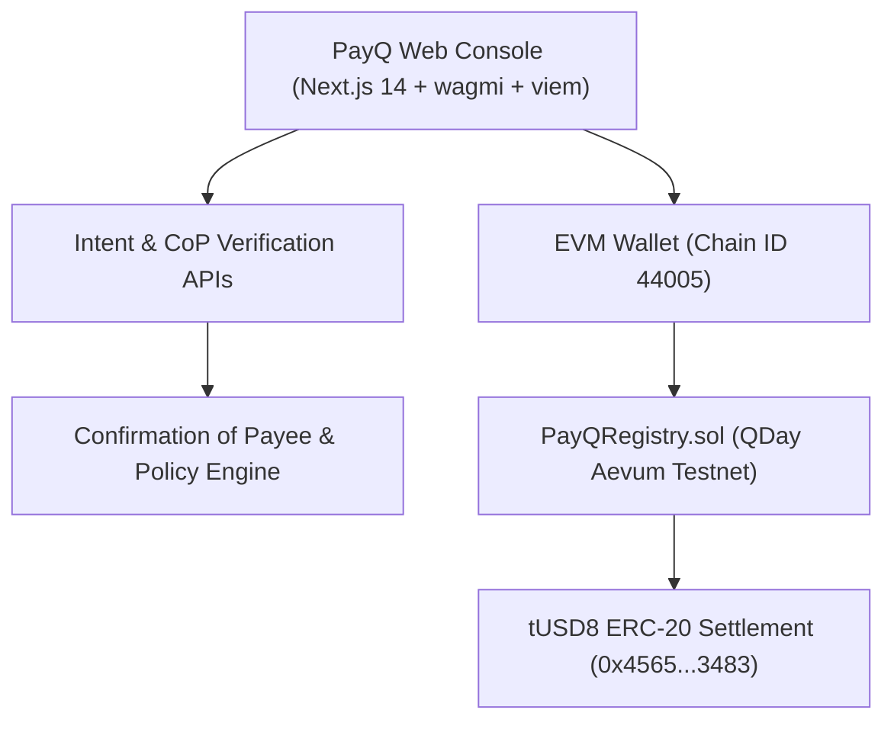

# PayQ — Post-Quantum Stablecoin Invoicing, Confirmation of Payee & AI Treasury on QDay Aevum

> **"Never send stablecoin funds to a spoofed address again. Protect AI-controlled capital with on-chain Confirmation of Payee and `tUSD8` Treasury Guardrails on QDay Aevum."**

Built for the **[Aevum Builder Challenge #1](https://dorahacks.io/hackathon/qday/detail)** on **QDay Aevum Testnet** (Chain ID `44005`).

---

## Hackathon Track Alignment

- **Confirmation of Payee (`PayQRegistry.sol`)**: On-chain directory binding EVM addresses to verified legal entities with 4 safety tiers (`VERIFIED`, `WARNING`, `UNVERIFIED`, `MISMATCH`), preventing lookalike/address-spoofing invoice fraud.
- **Invoice Payments (`tUSD8`)**: Multimodal AI invoice ingestion (PDF/image OCR), structured draft creation, on-chain `tUSD8` (6 decimals) settlement, and downloadable PDF audit receipts.
- **Native AI Assistants (`PayQ AI Copilot`)**: Natural-language payment intent resolution (*"Pay Acme Design 50 tUSD8 on Aevum"*) with deterministic policy evaluation.
- **Treasury Guardrails (`/treasury`)**: Single-transaction ceilings (`500 tUSD8`), rolling 24-hour velocity caps (`2,500 tUSD8`), and an on-chain emergency killswitch (`setPaused`).

---

## QDay Aevum Testnet Configuration

| Parameter | Value |
| :--- | :--- |
| **Network Name** | QDay Aevum Testnet |
| **Chain ID** | `44005` (`0xABE5`) |
| **RPC URL** | `https://rpc-test.qday.info` |
| **WebSocket URL** | `wss://rpc-test.qday.info` |
| **Block Explorer** | `https://explorer-test.qday.info` |
| **Native Gas Token** | `tQDAY` (18 decimals) |
| **Test Stablecoin (`tUSD8`)** | `0x456569838f1d43009A91ebA4263147Afd7233483` (ERC-20, 6 decimals) |
| **PayQRegistry (Live CoP Contract)** | [`0x6e9ba39CedDa49eb2647Aef28ae30da9B005fc21`](https://explorer-test.qday.info/address/0x6e9ba39CedDa49eb2647Aef28ae30da9B005fc21) |
| **Faucet** | `https://faucet.qday.info` (`0xE5074CBbd046AFb491EB8692abD6cF7ECCC6dEE5`) |

---

## Architecture



---

## Repository Structure

```text
PayQ/
├── contracts/
│   └── aevum/
│       ├── contracts/
│       │   ├── PayQRegistry.sol   # On-chain CoP, tUSD8 settlement & guardrails
│       │   └── MockTUSD8.sol      # 6-decimal ERC-20 mock for local Hardhat tests
│       ├── scripts/deploy.ts      # Aevum Testnet deployment script
│       ├── test/PayQRegistry.test.ts
│       └── hardhat.config.ts
├── docs/
│   └── AEVUM_HACKATHON.md         # Aevum Builder Challenge #1 reference
├── prisma/
│   └── schema.prisma              # PostgreSQL schema (tUSD8 / Chain ID 44005)
├── src/
│   ├── app/                       # Dashboard, Invoices, Pay, Treasury, Recipients, History
│   ├── context/WalletContext.tsx  # wagmi + viem QDay Aevum wallet & tUSD8 provider
│   └── lib/aevum/config.ts        # Aevum Testnet chain, tUSD8 & PayQRegistry ABIs
└── backend/                       # Optional NestJS API service
```

---

## Getting Started

1. **Install dependencies**
   ```bash
   pnpm install
   ```

2. **Configure environment**
   ```bash
   cp .env.example .env
   ```

3. **Compile & test the Solidity smart contracts**
   ```bash
   pnpm --dir contracts/aevum compile
   pnpm --dir contracts/aevum test
   ```

4. **Deploy `PayQRegistry.sol` to QDay Aevum Testnet**
   ```bash
   # Set AEVUM_DEPLOYER_PRIVATE_KEY in .env (funded with tQDAY from https://faucet.qday.info)
   pnpm --dir contracts/aevum deploy:aevum
   ```
   Then set `NEXT_PUBLIC_PAYQ_REGISTRY_ADDRESS` in `.env` to the deployed contract address.

5. **Run the web app**
   ```bash
   pnpm dev
   ```
